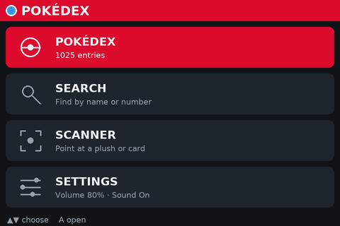
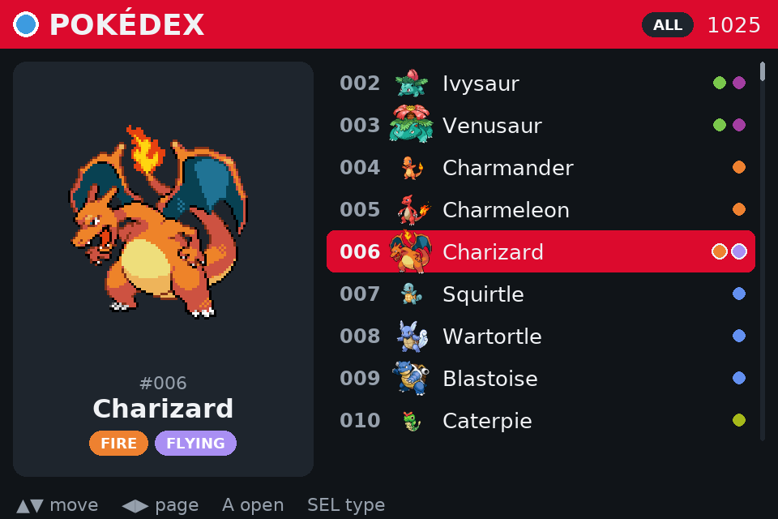
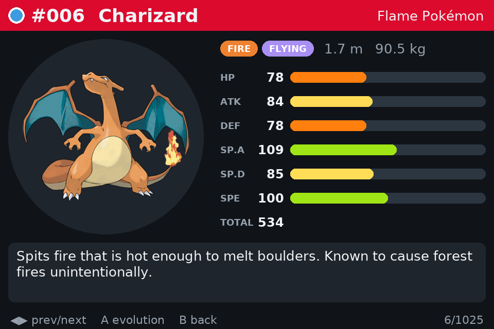
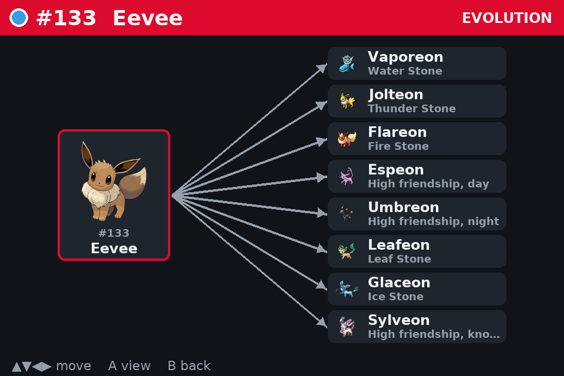
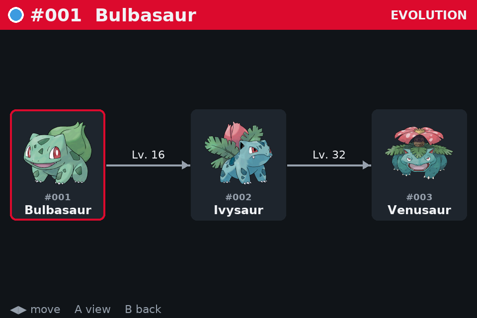
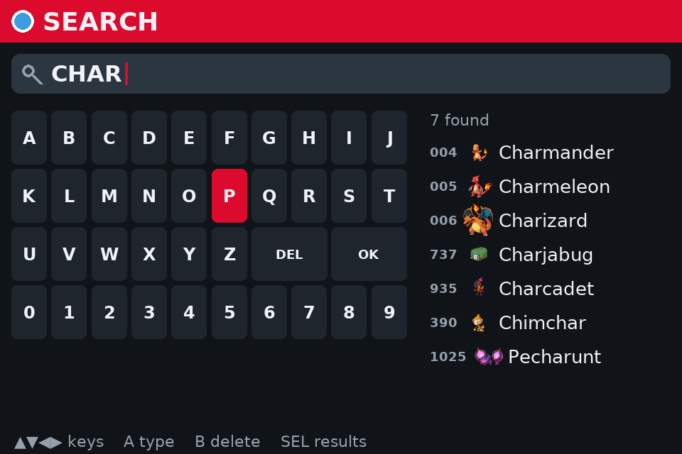
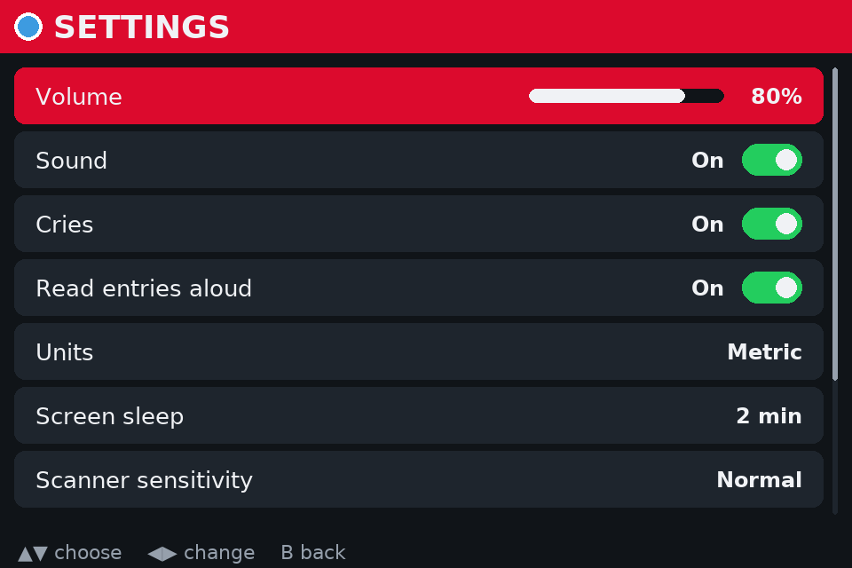
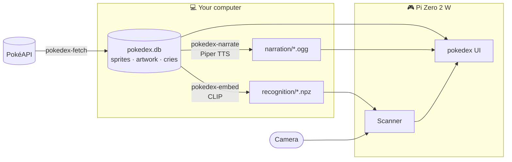

<div align="center">



# Pokédex

**A real, working Pokédex for a 3D-printed handheld.**<br>
Browse or search all 1,025 Pokémon, hear each one's cry and its entry read aloud, and point the camera at a plush or trading card to look it up. Fully offline.

<br>


[Features](#-features) ·
[Quick start](#-quick-start) ·
[How it works](#-how-it-works) ·
[Controls](#-controls) ·
[Scanner](#-scanner) ·
[Settings](#%EF%B8%8F-settings) ·
[Raspberry Pi](#-on-the-raspberry-pi-zero-2-w) ·
[Development](#%EF%B8%8F-development)

</div>

---

## ✨ Features

<table>
  <tr>
    <td width="50%"></td>
    <td width="50%"></td>
  </tr>
  <tr>
    <td align="center"><b>Browse all 1,025</b><br><sub>Scrolling list with sprites and type colours. SELECT filters by type.</sub></td>
    <td align="center"><b>Full entries</b><br><sub>Artwork, types, size, base stats and Pokédex text, then the cry and narration.</sub></td>
  </tr>
  <tr>
    <td></td>
    <td></td>
  </tr>
  <tr>
    <td align="center"><b>Evolution chains</b><br><sub>Branches like Eevee fan out with how each evolution happens.</sub></td>
    <td align="center"><b>Readable conditions</b><br><sub>"Lv. 16", "Fire Stone", "Trade holding Metal Coat". Jump to any member.</sub></td>
  </tr>
  <tr>
    <td></td>
    <td></td>
  </tr>
  <tr>
    <td align="center"><b>Search</b><br><sub>On-screen keyboard for the D-pad. By name or number; "mrmime" finds Mr. Mime.</sub></td>
    <td align="center"><b>Settings that stick</b><br><sub>Sound, units, screen sleep, scanner tuning, and a safe shut down.</sub></td>
  </tr>
</table>

- 🔊 **Cries and narration.** Each entry plays the Pokémon's cry, then reads itself aloud: *"Pikachu, the Mouse Pokémon. When several of these Pokémon gather…"*
- 📷 **Scanner.** Press START, point the camera and press A. Cards are read by name and open straight away; plushies and figures are recognised by picture, with an "Is it…?" pick when it isn't sure. All on the device.
- 🔎 **Search without a keyboard.** An on-screen keyboard driven by the D-pad and A, with results as you type. B from an entry goes back to your search.
- 🎮 **Built for buttons.** D-pad, A, B and SELECT, read as keyboard keys so GPIO buttons need no code. Touch works too.
- 🍓 **Pi Zero friendly.** Redraws only when you press something, keeps image memory bounded, and does the heavy lifting (speech, recognition references) on your computer.
- 📴 **No network needed.** Everything is fetched once into SQLite and files.

---

## 🚀 Quick start

### 1. Clone and install

Install [uv](https://docs.astral.sh/uv/) if you don't have it, then:

```sh
git clone https://github.com/<your-username>/pokedex.git
cd pokedex
uv sync
```

`uv sync` installs Python 3.12 if needed, plus every dependency, into `.venv/`.

### 2. Get the data

> [!IMPORTANT]
> **The repository contains no Pokémon data.** Artwork, cries, narration and models come to about 1.6 GB, so they're git-ignored and you build them yourself. Only step 2a is required; the app works without the others.

**2a. Download the Pokédex** from [PokéAPI](https://pokeapi.co) (required):

```sh
uv run pokedex-fetch --last 1025     # all 1,025 Pokémon
uv run pokedex-fetch                 # or just Gen 1 to try it out
```

**2b. Generate spoken entries** (optional):

```sh
uv run --extra narrate pokedex-narrate
```

**2c. Build the scanner references** (optional, only for the scanner):

```sh
uv run --extra recognize pokedex-embed
```

| Step | What it creates | Downloads | Time (all 1,025) |
| --- | --- | --- | --- |
| **2a** `pokedex-fetch` | Database, sprites, artwork, cries, evolution chains | ~150 MB | about an hour |
| **2b** `pokedex-narrate` | A spoken entry per Pokémon | ~115 MB voice + ~90 MB audio | 30–45 minutes |
| **2c** `pokedex-embed` | One picture-matching reference per Pokémon | ~700 MB CLIP model | about 10 minutes |

Gen 1 only (`pokedex-fetch` with no options) takes a few minutes for each step.

> [!TIP]
> Re-running any step is safe: anything already downloaded or generated is skipped, so an interrupted run picks up where it stopped. After fetching more Pokémon, run 2b and 2c again to cover the new ones.

### 3. Open it

```sh
uv run pokedex
```

---

## 🧩 How it works

Everything heavy happens once on your computer. The device only reads files.



| Command | What it does | Where it runs |
| --- | --- | --- |
| `pokedex-fetch` | Pokémon data, sprites, artwork, cries and evolution chains into `data/` | Computer |
| `pokedex-narrate` | Reads every entry aloud with an offline voice | Computer |
| `pokedex-embed` | Builds one picture-matching reference per Pokémon | Computer |
| `pokedex` | The handheld UI | Device |

---

## 🎮 Controls

The UI reads buttons as keyboard keys, so physical buttons only need to send these keys.

| Button | Keys | Home | Search | Settings | List | Entry | Evolution |
| :---: | --- | --- | --- | --- | --- | --- | --- |
| ▲▼ | Up / Down | Choose | Move on keyboard / results | Choose | Move | Prev / next | Between branches |
| ◀▶ | Left / Right | | Move on keyboard | Change value | Jump a page | Prev / next | Between stages |
| **A** | Enter, Space, Z | Open | Type key / open result | Flip switch | Open entry | Evolution chain | Open that entry |
| **B** | Esc, Backspace, X | | Delete letter, then home | Back home | Clear filter, then home | Back to list or search | Back to entry |
| **SELECT** | Tab, S | | Jump to results | | Cycle type filter | | |
| **START** | F1, C | Scanner from any screen. On the scanner: A scans, B goes back, ▲▼ and A pick a guess. | | | | | |

On a computer you can also type straight into the search.

<details>
<summary><b>Touch controls and shortcuts</b></summary>

<br>

- Tapping the **header** goes back a screen.
- **Home:** tap an entry to open it.
- **Search:** tap keys to type and a result to open it.
- **Settings:** tap a switch to flip it; tap the left or right half of the volume row to change it.
- **List:** tap a row to select it, tap again to open it; tap the type filter to cycle it.
- **Entry:** tap the left or right edge for previous/next, the middle for the evolution chain.
- **Evolution:** tap a Pokémon to select it, tap again to open it.
- **M** toggles sound and **Ctrl+Q** quits.

</details>

---

## 🔊 Spoken entries

Entries are read aloud by [Piper](https://github.com/OHF-Voice/piper1-gpl), an offline text-to-speech engine, with a light "device" effect (small-speaker tone, metallic resonance, faint electronic edge) so it sounds like it comes from a gadget.

```sh
uv run --extra narrate pokedex-narrate                                  # new entries only
uv run --extra narrate pokedex-narrate --voice en_GB-cori-high --force  # another voice
uv run --extra narrate pokedex-narrate --clean --force                  # no effect
```

<details>
<summary><b>Voices, pronunciation and file sizes</b></summary>

<br>

- **Voice:** `en_US-ryan-high` by default. Its licence allows personal, non-commercial use only. Any [Piper voice](https://huggingface.co/rhasspy/piper-voices) name works and downloads to `data/voices/` the first time (60–120 MB). Voice licences vary, so check the model card before sharing recordings.
- **Pronunciation:** "Pokémon" and "Poké Ball" are respelled so the voice says *POH-kay-mon*. Add any other word it gets wrong to `PRONUNCIATIONS` in [`script.py`](src/pokedex/narrator/script.py).
- **Effect:** the settings are in [`effects.py`](src/pokedex/narrator/effects.py).
- **Size:** about a second and 45 KB per entry.
- **Only needed for generating:** a plain `uv sync` removes the narration packages again, which is what you want on the Pi.

</details>

---

## 📷 Scanner

Point the Pokédex at something and it works out which Pokémon it is, offline, in two ways:

| | How | Why |
| --- | --- | --- |
| 🃏 **Cards** | Reads the printed name with PaddleOCR's small English models (11 MB) and matches it against all 1,025 names, allowing for a misread letter | Card names are big and clear, so this is near-certain |
| 🧸 **Plushies and figures** | Picture matching with CLIP: the camera frame is compared against a reference per Pokémon, built from its artwork and prompts like *"a photo of a Pikachu plush toy"* | Works on any object, with no training photos |

**Real-world results so far:** every card named correctly (Bulbasaur, Ekans, and Zoroark, which picture matching alone got wrong), and Pikachu and Bulbasaur plushies recognised by picture. About 0.2 s per scan on a laptop.

```sh
uv sync --extra recognize
uv run --extra recognize pokedex-embed      # after fetching
uv run --extra recognize pokedex            # START opens the scanner (your webcam on a computer)
```

On the scanner screen, a card's name opens its entry straight away. A picture match opens straight away when it's sure enough (60% by default; **Scanner sensitivity** in Settings makes that stricter or more relaxed); otherwise the top three are offered to choose from. If the camera is mounted upside down, turn on **Camera upside down** in Settings. The models load in the background when the app starts, and the camera only runs while the scanner is open.

| Option | Use |
| --- | --- |
| `--camera 1` | Pick a different webcam (or `/dev/video0` on Linux). By default the Pi Camera Module is used when present. |
| `--scanner-model clip-vit-base-patch16` | Sharper recognition for a Pi 5. Build its references first with `pokedex-embed --model clip-vit-base-patch16`. |
| `--no-scanner` | Skip loading the scanner, to save memory. |

<details>
<summary><b>Models, accuracy and design notes</b></summary>

<br>

- **Model:** `clip-vit-base-patch32`, quantized, sized for the Pi Zero 2 W. On artwork pasted onto cluttered backgrounds it named the right Pokémon first 63% of the time and in its top three 85% of the time. `--model clip-vit-base-patch16` reaches 85% / 97% but is several times slower, which suits a Pi 5.
- **No PyTorch or OpenCV:** both models run on ONNX Runtime, with numpy, scipy and Pillow around them. That keeps the Pi install small and avoids builds that don't exist for older Macs.
- **Pi Camera Module without picamera2:** frames come from the `rpicam-vid` command that ships with Raspberry Pi OS, because picamera2 only installs into the system Python, not the one uv manages. Webcams go through ffmpeg.
- **Accuracy test tool:** `uv run --extra recognize python -m pokedex.recognizer.try_camera` shows the top three guesses with scores and saves every scan to `data/scans/`, named after its top guess, for reviewing misses. `--no-cards` tests picture matching alone.

</details>

---

## ⚙️ Settings

Everything is changed on the device and saved to `data/settings.json`.

| Setting | Options |
| --- | --- |
| **Volume**, **Sound**, **Cries**, **Read entries aloud** | What plays when an entry opens. M toggles sound on a keyboard. |
| **Units** | Metric (1.7 m, 90.5 kg) or imperial (5'07", 199.5 lbs), as the games show them. |
| **Screen sleep** | Blank the screen after 1, 2, 5 or 10 idle minutes, or never. Any button wakes it, and that press does nothing else. The camera and audio stop while it sleeps. |
| **Scanner sensitivity** | Strict, normal or relaxed: how sure a picture match must be to open without asking. |
| **Camera upside down** | For a camera mounted inverted in the shell. |
| **Restart**, **Shut down** | Safe power-off, so the SD card isn't damaged. Press A twice to confirm. Only works on a Raspberry Pi. |

---

## 🍓 On the Raspberry Pi Zero 2 W

| Part | Notes |
| --- | --- |
| **Raspberry Pi Zero 2 W** | Needs 64-bit Raspberry Pi OS. Small and cool enough for a slim shell. |
| **Screen** | Any size: the layout is designed at 480×320 and scales. |
| **Buttons** | D-pad, A, B, SELECT and START, wired to GPIO. |
| **Speaker** | The Zero has no audio jack: use an I2S amp board (e.g. MAX98357A) or USB audio. Without one, it runs silently. |
| **Camera** | Camera Module 3 with a 22-pin "Pi 5 / Zero" camera cable (the standard cable it comes with doesn't fit either board). |

> [!NOTE]
> **Testing on a Pi 5 first?** Everything here works the same: it uses the same camera connector and cable, and also has no audio jack. It can afford the sharper `--scanner-model clip-vit-base-patch16`.

**1. Install with the scanner, and run without a desktop.** On Raspberry Pi OS Lite (64-bit), pygame draws straight to the display:

```sh
uv sync --extra recognize
SDL_VIDEODRIVER=kmsdrm uv run --extra recognize pokedex --fullscreen
```

The camera is read with `rpicam-vid`. If it's missing, install it with `sudo apt install rpicam-apps-lite`.

**2. Map buttons to keys** with the `gpio-key` overlay in `/boot/firmware/config.txt`, one line per button:

```ini
dtoverlay=gpio-key,gpio=17,active_low=1,gpio_pull=up,keycode=103
```

Keycodes: Up 103 · Down 108 · Left 105 · Right 106 · Enter 28 (A) · Esc 1 (B) · Tab 15 (SELECT) · F1 59 (START).

> [!NOTE]
> **Shut down and screen sleep on the Pi.** Shut down and Restart run `sudo shutdown` / `sudo reboot` without a password prompt, which works for Raspberry Pi OS's default user. Screen sleep turns the backlight off through `/sys/class/backlight` where the screen supports it; otherwise the screen just goes black.

**3. Copy `data/` over** rather than fetching on the Pi: about 350 MB for all 1,025 Pokémon with narration and the scanner. Leave out `data/voices/` and every model in `data/models/` except `vision_model_quantized.onnx` and the OCR folder; the Pi doesn't need the rest.

---

## 🗂️ Data

<details>
<summary><b>What's in <code>data/</code></b></summary>

<br>

```
data/
  pokedex.db           SQLite: pokemon, evolution_chain, evolution
  sprites/0025.png     96×96 game sprite
  artwork/0025.png     475×475 official artwork
  cries/0025.ogg       modern cry (some are MP3 inside; pygame plays both)
  narration/0025.ogg   spoken entry (pokedex-narrate)
  recognition/*.npz    scanner references (pokedex-embed)
  models/              CLIP and OCR models
  voices/              Piper voices (only for pokedex-narrate)
  settings.json        the device's settings
  scans/               webcam test captures
```

`data/` is git-ignored: anyone cloning the project regenerates it with the commands above.

</details>

<details>
<summary><b>Database schema</b></summary>

<br>

- **`pokemon`** has one row per National Pokédex number: name, genus, `type1`/`type2`, `height_dm`/`weight_hg` (decimetres and hectograms, as PokéAPI stores them), the six base stats (`hp`, `attack`, `defense`, `sp_attack`, `sp_defense`, `speed`), `flavor_text`, file paths relative to `data/` (`sprite_path`, `artwork_path`, `cry_path`, `narration_path`) and `evolution_chain_id`.
- **`evolution_chain`** has one row per family, and **`evolution`** one row per step, with a readable `method`. Chains include species you haven't fetched yet by name, so the UI can show them greyed out.

Query it directly:

```sh
sqlite3 -header -column data/pokedex.db
```

```sql
SELECT name, hp + attack + defense + sp_attack + sp_defense + speed AS total
  FROM pokemon ORDER BY total DESC LIMIT 10;
```

In VS Code, the **SQLite Viewer** extension opens `pokedex.db` as a browsable table.

</details>

<details>
<summary><b>Using the code from Python</b></summary>

<br>

```python
from pokedex import DataPaths, PokedexDB

paths = DataPaths()
with PokedexDB(paths.db) as db:
    charizard = db.get(6)  # Charizard, ('fire', 'flying'), stats.total 534
    image = paths.resolve(charizard.artwork_path)
    fire_types = db.by_type("fire")
```

</details>

---

## 🛠️ Development

```sh
uv run --all-extras pytest            # tests (offline; no display or network needed)
uv run ruff check . && uv run ruff format .
uv run python scripts/readme_images.py   # regenerate the README screenshots and GIF
uv add <package>                      # add a dependency (commit pyproject.toml and uv.lock)
```

<details>
<summary><b>Project layout</b></summary>

<br>

```
src/pokedex/
  models.py          Pokemon and BaseStats (Pydantic), shared everywhere
  db.py              PokedexDB: the SQLite tables as Pokemon objects
  paths.py           DataPaths: where everything in data/ lives
  search.py          name and number search, ignoring punctuation and accents
  units.py           metric and imperial heights and weights
  camera.py          Pi Camera Module (rpicam-vid) and webcams (ffmpeg)
  fetcher/           pokedex-fetch: PokéAPI client, records, evolution chains
  narrator/          pokedex-narrate: entry text, Piper voice, device effect
  recognizer/        pokedex-embed and the scanner: CLIP, card OCR, matching
  ui/
    app.py           the pokedex command: event loop, key and touch input
    state.py         navigation state and button actions (no pygame, easy to test)
    keyboard.py      on-screen keyboard layout and D-pad movement
    render.py        draws every screen
    sound.py         cry then narration; silent without audio
    scanner_service.py  camera and recognition on background threads
    power.py         screen sleep, backlight, safe shut down and restart
    settings.py      volume and switches, saved to data/settings.json
    assets.py        image loading with a size-limited cache
    theme.py         colours, type colours, fonts
    fonts/           DejaVu Sans (covers the ♀/♂ in Nidoran's names)
scripts/             README image generator
tests/               offline test suite
```

</details>

---

## 🙏 Credits

- Pokémon data, sprites, artwork and cries from [**PokéAPI**](https://pokeapi.co), a free community API.
- Speech by [**Piper**](https://github.com/OHF-Voice/piper1-gpl); voice models from [rhasspy/piper-voices](https://huggingface.co/rhasspy/piper-voices).
- Picture matching with OpenAI's [**CLIP**](https://github.com/openai/CLIP), using [Xenova's ONNX exports](https://huggingface.co/Xenova/clip-vit-base-patch32).
- Card reading with [**PaddleOCR**](https://github.com/PaddlePaddle/PaddleOCR) models, via [RapidOCR](https://github.com/RapidAI/RapidOCR)'s ONNX files.
- Text in [**DejaVu Sans**](https://dejavu-fonts.github.io/), whose licence is in [`src/pokedex/ui/fonts/`](src/pokedex/ui/fonts/).

<div align="center">
<sub>A personal fan project. Pokémon and Pokémon character names are trademarks of Nintendo, Creatures Inc. and GAME FREAK inc. This project is not affiliated with or endorsed by them.</sub>
</div>
